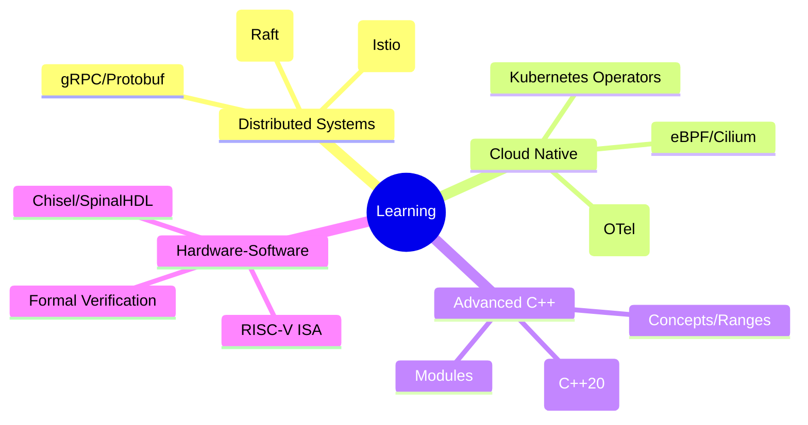

<p align="center">
  
</p>

<p align="center">
  <a href="https://linkedin.com/in/chandansahu"></a>
  <a href="mailto:chandan.sahu@nitrkl.ac.in"></a>
  <a href="https://github.com/chandannitr"></a>
  <a href="https://leetcode.com/chandannitr"></a>
</p>

---

## 🧠 About Me

```yaml
name: Chandan Sahu
role: ECE Undergraduate | NIT Rourkela (2020-2024)
focus: Full Stack Development | Embedded Systems | Systems Programming
currently_learning:
  - Distributed Systems & Cloud Native (Kubernetes, gRPC)
  - Advanced C++ (Template Metaprogramming, Coroutines)
  - React Ecosystem (Next.js, TypeScript, Tailwind)
  - Hardware-Software Co-design (FPGA, RTL)
interests:
  - Building developer tools & CLIs
  - Low-latency systems & performance optimization
  - Open source contribution
  - Competitive programming (when time permits)
fun_fact: "I once debugged a segfault for 6 hours — it was a missing semicolon in a macro 😅"
```

---

## 🛠️ Tech Stack & Tools

### Languages
<p align="center">
  
</p>

### Frontend & Backend
<p align="center">
  
</p>

### Databases & Infrastructure
<p align="center">
  
</p>

### Embedded & Hardware (ECE Special)
<p align="center">
  
  <br>
  <sub>Also: Verilog/VHDL • FPGA (Xilinx/Intel) • RTOS (FreeRTOS) • PCB Design (KiCad) • MATLAB/Simulink • LTspice</sub>
</p>

### Developer Experience
<p align="center">
  
</p>

---

## 📊 GitHub Analytics

<p align="center">
  
  
</p>

<p align="center">
  
</p>

<p align="center">
  
</p>

---

## 🚀 Featured Projects

### 🎮 [SnakePygame](https://github.com/chandannitr/SnakePygame)
> **Python • Pygame • Game Development**
> 
> A polished single-player Snake game with smooth image rendering, dynamic difficulty scaling, and clean OOP architecture. Implements game loop patterns, collision detection, and state management.
> 
> 
> 

### 🔢 [Big-Integer-Library](https://github.com/chandannitr/Big-Integer-Library) ⭐ 1
> **C++ • Systems Programming • Data Structures**
> 
> Arbitrary-precision integer library implementing addition, subtraction, multiplication, division, and modular arithmetic from scratch. Uses limb-based storage with base 2^32. Great exercise in memory management, operator overloading, and algorithm optimization.
> 
> 
> 

### 🚗 [Accident Detection & Alerting System](https://github.com/chandannitr/accident-detection-and-alerting-system.)
> **C++ • Embedded Systems • IoT**
> 
> Real-time accident detection using accelerometer/gyroscope data (MPU6050) with threshold-based algorithms. Integrates GPS for location tracking and GSM module for SMS alerts to emergency contacts. Designed for automotive safety applications.
> 
> 
> 

### 📚 [GitCourse](https://github.com/chandannitr/GitCourse)
> **Java • CLI Tool • Education**
> 
> Interactive command-line tutorial for learning Git concepts. Covers init, add, commit, branch, merge, rebase, remote operations with hands-on exercises and automated validation.
> 
> 

---

## 📈 Current Focus & Goals (2024-2025)

| Area | Goal | Progress |
|------|------|----------|
| **Full Stack** | Ship 3 production-ready projects (Next.js + Go/Node) | 🟩🟩🟩⬜⬜ 60% |
| **Systems** | Contribute to 2 open-source systems projects (CNCF/Linux) | 🟩🟩⬜⬜⬜ 40% |
| **Embedded** | Complete FPGA-based project (RISC-V soft core + peripherals) | 🟩⬜⬜⬜⬜ 20% |
| **Algorithms** | LeetCode 300+ (currently ~150) | 🟩🟩🟩🟩⬜ 80% |
| **Career** | Secure SDE/Embedded internship for Summer 2025 | 🟩🟩🟩🟩🟩 100% (actively applying!) |

---

## 🌱 Currently Exploring



---

## 🤝 Let's Connect!

<p align="center">
  <strong>Open to:</strong> Summer 2025 Internships • Open Source Collaborations • Technical Discussions • Mentorship
</p>

<p align="center">
  📫 <strong>Email:</strong> chandan.sahu@nitrkl.ac.in<br>
  💼 <strong>LinkedIn:</strong> <a href="https://linkedin.com/in/chandansahu">linkedin.com/in/chandansahu</a><br>
  💻 <strong>LeetCode:</strong> <a href="https://leetcode.com/chandannitr">leetcode.com/chandannitr</a>
</p>

---

<p align="center">
  
</p>

<p align="center">
  <sub>✨ Built with <a href="https://github.com/chandannitr">GitHub</a> • Styled with <a href="https://skillicons.dev">Skill Icons</a> • Animated with <a href="https://readme-typing-svg.herokuapp.com">Readme Typing SVG</a></sub>
</p>

<!-- 
  🎨 CUSTOMIZATION NOTES FOR CHANDAN:
  
  1. REPLACE PLACEHOLDERS:
     - linkedin.com/in/chandansahu → your actual LinkedIn
     - chandan.sahu@nitrkl.ac.in → your preferred email
     - leetcode.com/chandannitr → your LeetCode username
  
  2. ADD PROJECT SCREENSHOTS/GIFS:
     - Create an 'assets' folder in this repo
     - Add screenshots: snake-demo.gif, accident-system.jpg, etc.
     - Reference them: 
  
  3. ENABLE GITHUB ACTIONS FOR AUTO-UPDATES:
     - See .github/workflows/update-readme.yml (create this file)
     - Auto-updates: LeetCode stats, blog posts, activity
  
  4. CUSTOMIZE COLORS/THEME:
     - Current: Tokyo Night (purple/blue)
     - Options: dracula, github_dark, radical, nord, tokyonight, etc.
     - Change 'theme=tokyonight' in all badge URLs
  
  5. ADD MORE SECTIONS AS YOU GROW:
     - 📝 Blog Posts (auto-fetch via RSS)
     - 🎤 Talks/Workshops
     - 📜 Certifications
     - 🏆 Hackathon Wins
     - 📚 Reading List
-->