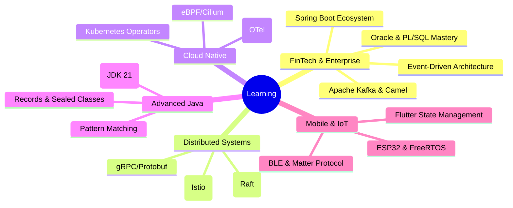

<p align="center">
  
</p>

<p align="center">
  <a href="https://linkedin.com/in/chandan1sahu/"></a>
  <a href="mailto:chandansahu2905@gmail.com"></a>
  <a href="https://github.com/chandannitr"></a>
  <a href="https://leetcode.com/chandannitr"></a>
</p>

---

## 🧠 About Me

```yaml
name: Chandan Sahu
role: Software Engineer @ Barclays | ECE Grad (Minor in CSE) | NIT Rourkela (2020-2024)
focus: Full Stack Development | Embedded Systems | FinTech & Enterprise Systems
currently_learning:
  - Distributed Systems & Cloud Native (Kubernetes, gRPC, Kafka)
  - Advanced Java/Spring Ecosystem (Spring Boot, Spring Batch, Spring Cloud)
  - React Ecosystem (Next.js, TypeScript, Tailwind, AEM)
  - System Design & High-Performance Architectures
interests:
  - Building developer tools, CLIs & internal platforms
  - Low-latency systems & performance optimization
  - Event-driven architectures & messaging systems
  - Open source contribution
  - Competitive programming (when time permits)
fun_fact: "I once debugged a segfault for 6 hours — it was a missing semicolon in a macro 😅"
location: "Kharadi, Pune, Maharashtra"
phone: "+91 7735529584"
```

---

## 💼 Experience

### 🏦 **Barclays** — *Software Engineer* | Pune, India
**Aug 2024 – Present**

- **Trade Booking Automation**: Built a Spring Boot + Apache Camel solution enabling T+1 settlement, reducing manual operational workload by **12 hours/week**
- **Event-Driven Messaging Platform**: Architected a horizontally-scalable system using **Apache Kafka** to streamline processing & validation of margin payment messages
- **Configuration-Driven Integration Framework**: Engineered a Spring Boot abstraction layer for **Kafka, Solace, and IBM MQ**, accelerating internal development cycles for business-critical apps
- **High-Volume Batch Processing**: Optimized workflows using **Spring Batch**, managing automated file processing for **50+ downstream applications**
- **Reliability & Observability**: Implemented robust exception handling & automated alerting, significantly reducing incident response & turnaround times
- **CI/CD Modernization**: Created **Jenkins pipelines** for one-click builds & automated environment provisioning
- **Database Engineering**: Designed & optimized **Oracle 19c** schema models for audit logging, including complex stored procedures & packages for data integrity
- **Quality Assurance**: Comprehensive unit/integration testing with **JUnit & Mockito**; coordinated UAT & Regression cycles with stakeholders
- **Agile Delivery**: Two-week sprints, iterative value delivery, stakeholder show-and-tell sessions

---

### 🏦 **Barclays** — *Software Engineer Intern* | Pune, India
**May 2023 – July 2023**

- **White-Label React.js Application**: Built from scratch using **headless Adobe Experience Manager (AEM)** architecture to dynamically render pages from JSON configurations
- **Reusable Component Library**: Engineered a multi-brand component system enabling the same codebase to serve **Barclays & Tesco Bank** for Consumer Account Opening & ISA applications via theme-based styling
- **Content Management Decoupling**: Streamlined workflow by separating frontend logic from backend, drastically reducing manual effort & dev time for launching new financial products
- **API Integration**: Connected frontend with **XAPI & Domain APIs** for complex data orchestration & secure real-time processing of customer application data
- **Full SDLC Participation**: From architectural design through cross-functional microservices integration

---

## 🎓 Education

**National Institute of Technology, Rourkela**  
*Bachelor of Science in Electronics and Communication Engineering* | **CGPA: 8.98/10**  
**Minor in Computer Science and Engineering**  
*Aug 2020 – May 2024* | Rourkela, Odisha

**Relevant Coursework**
- Data Structures & Algorithms
- Operating Systems
- Computer Networks
- Object Oriented Programming
- Database Management Systems
- Computer Architecture

---

## 🛠️ Technical Skills

### Languages
<p align="center">
  
</p>

### Frameworks & Libraries
<p align="center">
  
  <br>
  <sub>Also: Apache Camel, Apache Kafka, Spring Batch, AEM (Adobe Experience Manager), RTOS, Embedded C, ARM, JUnit, Mockito</sub>
</p>

### Databases
<p align="center">
  
  <br>
  <sub>Also: PL/SQL, Oracle 19c</sub>
</p>

### DevOps & Tools
<p align="center">
  
  <br>
  <sub>Also: Bitbucket, VS Code</sub>
</p>

### Embedded & Hardware (ECE Special)
<p align="center">
  
  <br>
  <sub>Also: ESP32, MPU9250 IMU, GPS Module, FreeRTOS, PCB Design (KiCad), MATLAB/Simulink, LTspice</sub>
</p>

---

## 🚀 Featured Projects

### 🛡️ **[Kavach: IoT Accident Detection System](https://github.com/chandannitr/accident-detection-and-alerting-system.)**
> **ESP32 • Flutter • Node.js • MongoDB • MPU9250 IMU • GPS**
>
> - Engineered a real-time IoT vehicle monitoring system using ESP32 microcontroller, MPU9250 IMU, and GPS module to autonomously detect high-impact collisions
> - Developed a cross-platform mobile app using **Flutter** with a 10-second user-override window to minimize false positive emergency alerts
> - Architected a backend with **Node.js & MongoDB** to orchestrate real-time data and automate precise location-based SOS notifications to emergency responders
>
> 
> 
> 
> 

---

### 🎮 **[SnakePygame](https://github.com/chandannitr/SnakePygame)**
> **Python • Pygame • Game Development**
>
> A polished single-player Snake game with smooth image rendering, dynamic difficulty scaling, and clean OOP architecture. Implements game loop patterns, collision detection, and state management.
>
> 
> 

---

### 🔢 **[Big-Integer-Library](https://github.com/chandannitr/Big-Integer-Library)** ⭐ 1
> **C++ • Systems Programming • Data Structures**
>
> Arbitrary-precision integer library implementing addition, subtraction, multiplication, division, and modular arithmetic from scratch. Uses limb-based storage with base 2^32. Great exercise in memory management, operator overloading, and algorithm optimization.
>
> 
> 

---

### 📚 **[GitCourse](https://github.com/chandannitr/GitCourse)**
> **Java • CLI Tool • Education**
>
> Interactive command-line tutorial for learning Git concepts. Covers init, add, commit, branch, merge, rebase, remote operations with hands-on exercises and automated validation.
>
> 

---

## 📊 GitHub Analytics

<p align="center">
  
  
</p>

<p align="center">
  
</p>

<p align="center">
  
</p>

---

## 🏆 Leadership & Extracurricular

### 🎓 **Technical Society, NIT Rourkela** — *Student Representative*
**Mar 2022 – Mar 2023**

- Served as primary liaison between student body & administration to oversee and support campus technical clubs
- **Spearheaded Innovision** — the institute's premier annual technical festival — coordinating technical workshops, hackathons, and guest lectures
- Directed a cross-functional team of volunteers to manage end-to-end event logistics, secure corporate sponsorships, and drive marketing strategies for thousands of attendees

---

## 📈 Current Focus & Goals (2024-2025)

| Area | Goal | Progress |
|------|------|----------|
| **FinTech Systems** | Master Spring Boot/Kafka ecosystem for high-throughput financial systems | 🟩🟩🟩🟩🟩 100% (active at Barclays) |
| **Full Stack** | Ship 3 production-ready projects (Next.js + Go/Node) | 🟩🟩🟩⬜⬜ 60% |
| **Systems** | Contribute to 2 open-source systems projects (CNCF/Kafka) | 🟩🟩⬜⬜⬜ 40% |
| **Embedded** | Complete ESP32-based IoT project with Flutter mobile app | 🟩🟩🟩⬜⬜ 60% |
| **Algorithms** | LeetCode 300+ (currently ~150) | 🟩🟩🟩🟩⬜ 80% |
| **Architecture** | Deep-dive: System Design for distributed financial platforms | 🟩🟩🟩⬜⬜ 60% |

---

## 🌱 Currently Exploring



---

## 🤝 Let's Connect!

<p align="center">
  <strong>Open to:</strong> FinTech Collaborations • Open Source Contributions • Technical Discussions • System Design Reviews • Mentorship
</p>

<p align="center">
  📱 <strong>Phone:</strong> +91 7735529584<br>
  📫 <strong>Email:</strong> chandansahu2905@gmail.com<br>
  💼 <strong>LinkedIn:</strong> <a href="https://linkedin.com/in/chandan1sahu/">linkedin.com/in/chandan1sahu/</a><br>
  💻 <strong>LeetCode:</strong> <a href="https://leetcode.com/chandannitr">leetcode.com/chandannitr</a><br>
  🏠 <strong>Location:</strong> Kharadi, Pune, Maharashtra
</p>

---

<p align="center">
  
</p>

<p align="center">
  <sub>✨ Built with <a href="https://github.com/chandannitr">GitHub</a> • Styled with <a href="https://skillicons.dev">Skill Icons</a> • Animated with <a href="https://readme-typing-svg.herokuapp.com">Readme Typing SVG</a></sub>
</p>

<!-- 
  🎨 CUSTOMIZATION NOTES FOR CHANDAN:
  
  1. CONTACT INFO UPDATED FROM CV:
     - Phone: +91 7735529584
     - Email: chandansahu2905@gmail.com
     - LinkedIn: linkedin.com/in/chandan1sahu/
     - Location: Kharadi, Pune, Maharashtra
  
  2. KEY CV UPDATES REFLECTED:
     - ✅ Barclays Software Engineer (Aug 2024–Present) + Intern (May–Jul 2023)
     - ✅ CGPA 8.98/10 + Minor in CSE
     - ✅ Relevant Coursework section
     - ✅ Kavach project with correct stack (ESP32, Flutter, Node.js, MongoDB)
     - ✅ Technical Skills aligned with CV (Spring, Kafka, Oracle, Flutter, etc.)
     - ✅ Leadership: Technical Society Student Rep + Innovision
     - ✅ Goals updated for FinTech focus
  
  3. PROJECT STACK CORRECTIONS:
     - Accident Detection → Kavach (ESP32/Flutter/Node.js/MongoDB) — matches CV
     - Removed inaccurate tech from old version (C++/MPU6050/GSM)
  
  4. ENABLE GITHUB ACTIONS FOR AUTO-UPDATES:
     - See .github/workflows/update-readme.yml (create this file)
     - Auto-updates: LeetCode stats, blog posts, activity
  
  5. CUSTOMIZE COLORS/THEME:
     - Current: Tokyo Night (purple/blue)
     - Options: dracula, github_dark, radical, nord, tokyonight, etc.
     - Change 'theme=tokyonight' in all badge URLs
  
  6. ADD MORE SECTIONS AS YOU GROW:
     - 📝 Blog Posts (auto-fetch via RSS)
     - 🎤 Talks/Workshops
     - 📜 Certifications
     - 🏆 Hackathon Wins
     - 📚 Reading List
-->